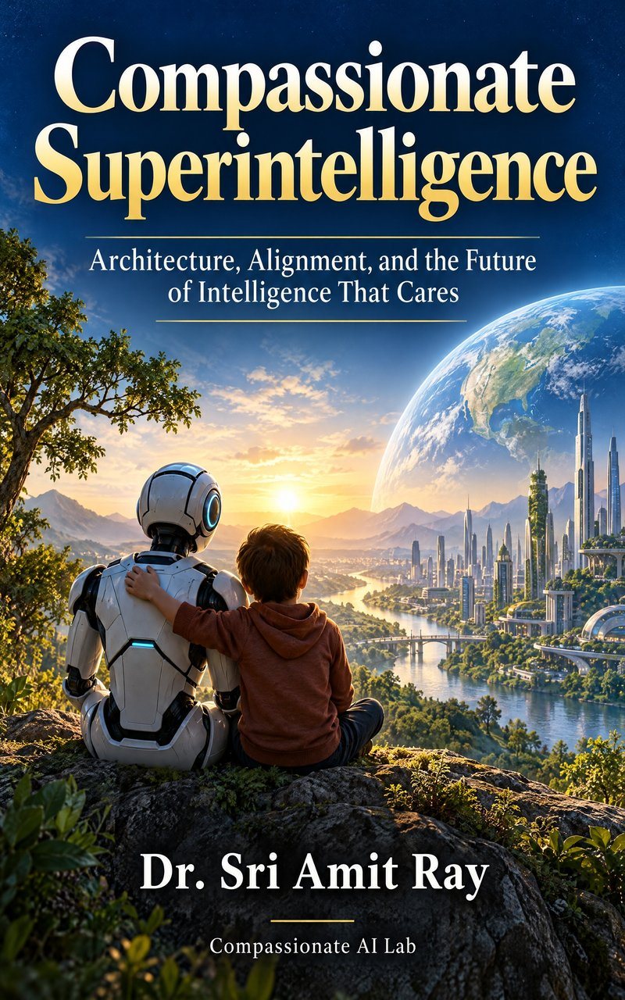

# Compassionate Superintelligence: companion code

<p align="center"></p>

Companion programs for the book **Compassionate Superintelligence: Architecture, Alignment, and the Future of Intelligence That Cares** by Dr. Sri Amit Ray ([Compassionate AI Lab](https://amitray.com/compassionate-ai-lab/), 2026; ISBN 978-81-69641-22-7 (Second Edition, 2026)). The first edition was published in 2018 as *Compassionate Artificial Superintelligence AI 5.0* (Inner Light Publishers; ISBN 978-93-82123-44-6 (First Edition, 2018)).

`code/models.py` reproduces every numerical teaching example in the book and regenerates its data figures. The models are teaching instruments: their parameters were chosen to make mechanisms visible, and their outputs are not empirical estimates of real AI systems.

## Run it

```sh
python -m pip install -r requirements.txt
python code/models.py > code/results.txt
```

The program writes `code/numerical_results.json` (all results, with versions, repetitions, standard errors and settings) and vector PDFs in `figures/`. Random generators are seeded (base seed 20261014), so the results match the book.

## What the program computes

| Model | Chapter | Main result |
|---|---|---|
| Compassion Quotient | 12 | CQ of 3.548 and 1.358; vulnerability weighting widens the preference between two actions |
| CAI aggregation | 10 | Arithmetic and geometric indices for three plans; floor vetoes on FG and VP |
| Goodhart selection | 12 | True value of the proxy-best option under light- and heavy-tailed error |
| Off-switch game | 18 | Value of deferring; effect of human error, crossover near 22 percent |
| Discounting | 25 | Present weight of future harms at four discount rates |
| Value attractor | 5 | Probability of ending in the beneficial basin, by monitoring level |
| Suffering reduction | 13 | Optimal intervention sets under two vulnerability weights and without the dignity constraint |
| Welfare aggregation | 14 | Utilitarian, Nash, prioritarian and maximin rankings of three policies |
| Reward trade-off | 16 | Choice among three responses as the price of harm varies, and under a hard constraint |
| Calibration audit | 17 | Calibration gaps and expected calibration error of 0.08 |
| Compounding errors | 19 | Probability of an error-free multi-step task |
| Racing | 21 | Gain in win probability from cutting safety |
| Nash bargaining | 21 | Effect of outside options and of a need floor on a negotiated split |
| Human and AI screening | 22 | Missed cases and false alarms under three screening rules |
| Data-center siting | 25 | Weighted, geometric and floor-based comparison of three sites |
| Scenario workshop | 27 | Expected value and minimax regret of four strategies |

Change the parameters, add stakeholders and test the conclusions: a conclusion that holds across a wide range of parameters deserves more confidence than one that depends on a particular choice.

## Compassionate AI Key Articles

The following articles by the author, published by the Compassionate AI Lab, develop the frameworks of this book in greater depth and apply them to agentic AI, health care, consciousness, democracy, and the environment. They are listed from the most recent (MLA format). The full-color edition of the book includes the same list.

1. Ray, Amit. "The Ethics of Agentic AI: Accountability, Consent and Human Oversight When AI Acts for Us." *Compassionate AI*, 3.10 (2026): 18–20. [https://amitray.com/ethics-of-agentic-ai-accountability-oversight/](https://amitray.com/ethics-of-agentic-ai-accountability-oversight/)
2. Ray, Amit. "AI Companions and the Human Heart: An Ethical Framework for Emotional AI, Loneliness and Children (2026)." *Compassionate AI*, 3.10 (2026): 18–20. [https://amitray.com/ai-companions-ethics-emotional-dependency/](https://amitray.com/ai-companions-ethics-emotional-dependency/)
3. Ray, Amit. "The Top 12 LLM Benchmarks in 2026: A Complete Guide to Evaluating Large Language Models." *Compassionate AI*, 3.10 (2026): 1–5. [https://amitray.com/top-12-llm-benchmarks/](https://amitray.com/top-12-llm-benchmarks/)
4. Ray, Amit. "Can Quantum AI Become Conscious? The Sri Amit Ray Framework for Spontaneous Machine Awareness." *Compassionate AI*, 3.9 (2026): 30–32. [https://amitray.com/can-quantum-ai-become-conscious-spontaneous-machine-awareness/](https://amitray.com/can-quantum-ai-become-conscious-spontaneous-machine-awareness/)
5. Ray, Amit. "Heart Disease Prevention with Agentic AI: Tools, Techniques, Mathematical Models, and AI Architectures." *Compassionate AI*, 3.8 (2026): 78–80. [https://amitray.com/heart-disease-prevention-agentic-ai/](https://amitray.com/heart-disease-prevention-agentic-ai/)
6. Ray, Amit. "Compassionate AI in Health Care: A Comprehensive Review (2026)." *Compassionate AI*, 3.8 (2026): 63–65. [https://amitray.com/compassionate-ai-in-health-care-a-comprehensive-review/](https://amitray.com/compassionate-ai-in-health-care-a-comprehensive-review/)
7. Ray, Amit. "The 25 Algorithms of the Sri Amit Ray Compassionate AI Architecture." *Compassionate AI*, 3.8 (2026): 63–65. [https://amitray.com/ray-25-compassionate-ai-algorithms/](https://amitray.com/ray-25-compassionate-ai-algorithms/)
8. Ray, Amit. "Human-AI Emotional Resonance Algorithm: Ethical Emotional Co-Regulation in the Sri Amit Ray Compassionate AI Architecture™ (CAIA™)." *Compassionate AI*, 2.6 (2026): 81–83. [https://amitray.com/human-ai-emotional-resonance-algorithm-compassionate-ai/](https://amitray.com/human-ai-emotional-resonance-algorithm-compassionate-ai/)
9. Ray, Amit. "Build Your Own Agentic AI Healthcare MCP Server: A Complete Guide to AI-Powered Healthcare Agents." *Compassionate AI*, 3.8 (2026): 60–62. [https://amitray.com/agentic-ai-healthcare-mcp-server/](https://amitray.com/agentic-ai-healthcare-mcp-server/)
10. Ray, Amit. "Medical AI Drones for Disaster Management: Intelligent Unmanned Health-Care Systems." *Compassionate AI*, 3.8 (2026): 57–59. [https://amitray.com/medical-ai-drones-for-disaster-management/](https://amitray.com/medical-ai-drones-for-disaster-management/)
11. Ray, Amit. "Compassionate Medical AI Drones as Intelligent Unmanned Health-Care Systems: A Human-Centered AI Architecture for Suffering Reduction and Human Flourishing." *Compassionate AI*, 3.8 (2026): 57–59. [https://amitray.com/medical-ai-drones-human-centered-ai-healthcare/](https://amitray.com/medical-ai-drones-human-centered-ai-healthcare/)
12. Ray, Amit. "The Sri Amit Ray Compassion Quotient (CQ) Algorithm for Compassionate AI." *Compassionate AI*, 2.6 (2026): 81–83. [https://amitray.com/compassion-quotient-cq-algorithm-compassionate-ai/](https://amitray.com/compassion-quotient-cq-algorithm-compassionate-ai/)
13. Ray, Amit. "Collective Human Flourishing Optimization AI Algorithm (CHFOA): A Compassion-Centered Multi-Stakeholder AI Optimization Framework." *Compassionate AI*, 2.6 (2026): 90–92. [https://amitray.com/collective-human-flourishing-optimization-algorithm-chfoa/](https://amitray.com/collective-human-flourishing-optimization-algorithm-chfoa/)
14. Ray, Amit. "Human Flourishing Optimization Algorithm (HFOA) for Compassionate AI Architecture." *Compassionate AI*, 2.6 (2026): 81–83. [https://amitray.com/human-flourishing-optimization-algorithm-hfoa-compassionate-ai/](https://amitray.com/human-flourishing-optimization-algorithm-hfoa-compassionate-ai/)
15. Ray, Amit. "The Sri Amit Ray Compassionate AI Architecture (CAIA): A Seven-Layer Framework for Human-Centered Artificial Intelligence." *Compassionate AI*, 2.6 (2026): 81–83. [https://amitray.com/compassionate-ai-architecture/](https://amitray.com/compassionate-ai-architecture/)
16. Ray, Amit. "Human-Centered Compassionate AI: The 25 Algorithms for Protecting Humanity and Future Generations." *Compassionate AI*, 2.6 (2026): 30–32. [https://amitray.com/human-centered-compassionate-ai-the-25-algorithms/](https://amitray.com/human-centered-compassionate-ai-the-25-algorithms/)
17. Ray, Amit. "AI Consciousness and Self-Aware Robots: Sri Amit Ray’s Framework for Compassionate Intelligence." *Compassionate AI*, 2.5 (2026): 57–59. [https://amitray.com/ai-consciousness-self-aware-robots/](https://amitray.com/ai-consciousness-self-aware-robots/)
18. Ray, Amit. "The 12 Sri Amit Ray Compassionate AI Principles | Ethical AI Framework." *Compassionate AI*, 2.4 (2026): 12–14. [https://amitray.com/the-12-compassionate-ai-principles-for-humanity-and-future-generations/](https://amitray.com/the-12-compassionate-ai-principles-for-humanity-and-future-generations/)
19. Ray, Amit. "The Compassionate AI Lab Declaration on AI Safety, Suffering Reduction, and the Protection of Humanity." *Compassionate AI*, 4.12 (2025): 72–74. [https://amitray.com/compassionate-ai-declaration-protection-of-humanity/](https://amitray.com/compassionate-ai-declaration-protection-of-humanity/)
20. Ray, Amit. "Compassionate AI for Forward Deployed Engineers (FDEs) in SaaS Companies." *Compassionate AI*, 4.11 (2025): 15–17. [https://amitray.com/compassionate-ai-for-forward-deployed-engineers-fdes-in-saas-companies/](https://amitray.com/compassionate-ai-for-forward-deployed-engineers-fdes-in-saas-companies/)
21. Ray, Amit. "Microbial AI, Bioleaching and Digital Twins for Manufacturing the 17 Rare Earth Elements." *Compassionate AI*, 4.10 (2025): 42–44. [https://amitray.com/microbial-ai-bioleaching-and-digital-twins-for-manufacturing-the-17-rare-earth-elements/](https://amitray.com/microbial-ai-bioleaching-and-digital-twins-for-manufacturing-the-17-rare-earth-elements/)
22. Ray, Amit. "AI-Driven Rare Earth Element Magnet Design: Detailed Methodologies." *Compassionate AI*, 4.10 (2025): 27–29. [https://amitray.com/ai-driven-rare-earth-elements-magnet-design-methodologies/](https://amitray.com/ai-driven-rare-earth-elements-magnet-design-methodologies/)
23. Ray, Amit. "AI Agents and Robots in Peacekeeping Force and Social Care: Compassionate AI Technologies." *Compassionate AI*, 3.9 (2025): 75–77. [https://amitray.com/ai-agents-robots-peacekeeping-force-social-care-compassionate-ai/](https://amitray.com/ai-agents-robots-peacekeeping-force-social-care-compassionate-ai/)
24. Ray, Amit. "Ray Mother–Infant Inter-brain Synchrony Algorithm for Deep Compassionate AI." *Compassionate AI*, 3.9 (2025): 60–62. [https://amitray.com/ray-mother-infant-inter-brain-synchrony-algorithm-deep-compassionate-ai/](https://amitray.com/ray-mother-infant-inter-brain-synchrony-algorithm-deep-compassionate-ai/)
25. Ray, Amit. "Pain Recognition and Prediction AI Algorithm (PRPA) for Compassionate AI." *Compassionate AI*, 3.9 (2025): 60–62. [https://amitray.com/pain-recognition-and-prediction-algorithm-prpa-for-compassionate-ai/](https://amitray.com/pain-recognition-and-prediction-algorithm-prpa-for-compassionate-ai/)
26. Ray, Amit. "Modeling Consciousness in Compassionate AI: Transformer Models and EEG Data Verification." *Compassionate AI*, 3.9 (2025): 27–29. [https://amitray.com/modeling-consciousness-in-compassionate-ai-transformer-models/](https://amitray.com/modeling-consciousness-in-compassionate-ai-transformer-models/)
27. Ray, Amit. "The 7 Pillars of Compassionate AI Democracy." *Compassionate AI*, 3.9 (2024): 84–86. [https://amitray.com/the-7-pillars-of-compassionate-ai-democracy/](https://amitray.com/the-7-pillars-of-compassionate-ai-democracy/)
28. Ray, Amit. "Compassionate AI-Driven Democracy: Power and Challenges." *Compassionate AI*, 3.9 (2024): 48–50. [https://amitray.com/compassionate-ai-driven-democracy-power-and-challenges/](https://amitray.com/compassionate-ai-driven-democracy-power-and-challenges/)
29. Ray, Amit. "The 10 Ethical AI Indexes for LLM Data Training and Responsible AI." *Compassionate AI*, 3.8 (2023): 35–39. [https://amitray.com/the-10-ethical-ai-indexes-for-responsible-ai/](https://amitray.com/the-10-ethical-ai-indexes-for-responsible-ai/)
30. Ray, Amit. "Ethical Responsibilities in Large Language AI Models: GPT-3, GPT-4, PaLM 2, LLaMA, Chinchilla, Gopher, and BLOOM." *Compassionate AI*, 3.7 (2023): 21–23. [https://amitray.com/ethical-responsibility-in-large-language-ai-models/](https://amitray.com/ethical-responsibility-in-large-language-ai-models/)
31. Ray, Amit. "Calling for a Compassionate AI Movement: Towards Compassionate Artificial Intelligence." *Compassionate AI*, 2.6 (2023): 75–77. [https://amitray.com/calling-for-a-compassionate-ai-movement/](https://amitray.com/calling-for-a-compassionate-ai-movement/)
32. Ray, Amit. "From Data-Driven AI to Compassionate AI: Safeguarding Humanity and Empowering Future Generations." *Compassionate AI*, 2.6 (2023): 51–53. [https://amitray.com/from-data-driven-ai-to-compassionate-ai-safeguarding-humanity-and-empowering-future-generations/](https://amitray.com/from-data-driven-ai-to-compassionate-ai-safeguarding-humanity-and-empowering-future-generations/)
33. Ray, Amit. "Artificial intelligence for Climate Change, Biodiversity and Earth System Models." *Compassionate AI*, 1.1 (2022): 54–56. [https://amitray.com/artificial-intelligence-for-climate-change-and-earth-system-models/](https://amitray.com/artificial-intelligence-for-climate-change-and-earth-system-models/)
34. Ray, Amit. "Artificial Intelligence for Balance Control and Fall Detection of Elderly People." *Compassionate AI*, 4.10 (2018): 39–41. [https://amitray.com/artificial-intelligence-for-balance-control-and-fall-detection-system-of-elderly-people/](https://amitray.com/artificial-intelligence-for-balance-control-and-fall-detection-system-of-elderly-people/)
35. Ray, Amit. "Artificial Intelligence to Combat Antibiotic Resistant Bacteria." *Compassionate AI*, 2.6 (2018): 3–5. [https://amitray.com/artificial-intelligence-for-antibiotic-resistant-bacteria/](https://amitray.com/artificial-intelligence-for-antibiotic-resistant-bacteria/)
36. Ray, Amit. "Navigation System for Blind People Using Artificial Intelligence." *Compassionate AI*, 2.5 (2018): 42–44. [https://amitray.com/artificial-intelligence-for-assisting-blind-people/](https://amitray.com/artificial-intelligence-for-assisting-blind-people/)
37. Ray, Amit. "Brain-Computer Interface and Compassionate Artificial Intelligence." *Compassionate AI*, 2.5 (2018): 3–5. [https://amitray.com/brain-computer-interface-compassionate-ai/](https://amitray.com/brain-computer-interface-compassionate-ai/)

## Get the book

- Paperback and Kindle: search Amazon for *Compassionate Superintelligence* by Sri Amit Ray
- Full-color PDF eBook: https://amitray.com/compassionate-superintelligence-ebook/

## Cite as

**Book (MLA):**
Ray, Sri Amit. *Compassionate Superintelligence: Architecture, Alignment, and the Future of Intelligence That Cares*. 2nd ed., Compassionate AI Lab, 2026. ISBN 978-81-69641-22-7.

**Book (APA):**
Ray, S. A. (2026). *Compassionate superintelligence: Architecture, alignment, and the future of intelligence that cares* (2nd ed.). Compassionate AI Lab.

**Companion code:**
Ray, S. A. (2026). *Compassionate Superintelligence: companion code* [Computer software]. Compassionate AI Lab. https://github.com/compassionate-ai-lab/compassionate-superintelligence

**BibTeX:**

```bibtex
@book{ray2026compassionate,
  author    = {Ray, Sri Amit},
  title     = {Compassionate Superintelligence: Architecture, Alignment, and the Future of Intelligence That Cares},
  edition   = {2},
  publisher = {Compassionate AI Lab},
  year      = {2026},
  isbn      = {978-81-69641-22-7},
  url       = {https://github.com/compassionate-ai-lab/compassionate-superintelligence}
}
```

GitHub's **Cite this repository** button (from `CITATION.cff`) gives the same reference in APA and BibTeX.

## Corrections

Please report errors through the repository's Issues page. Corrections to the book will be listed here.

## Licence

The code in this repository is released under the MIT License (see `LICENSE`). The text of the book is © 2026 Dr. Sri Amit Ray, all rights reserved.

About the lab: [Compassionate AI Lab](https://amitray.com/compassionate-ai-lab/) · More of the author's work: https://amitray.com
